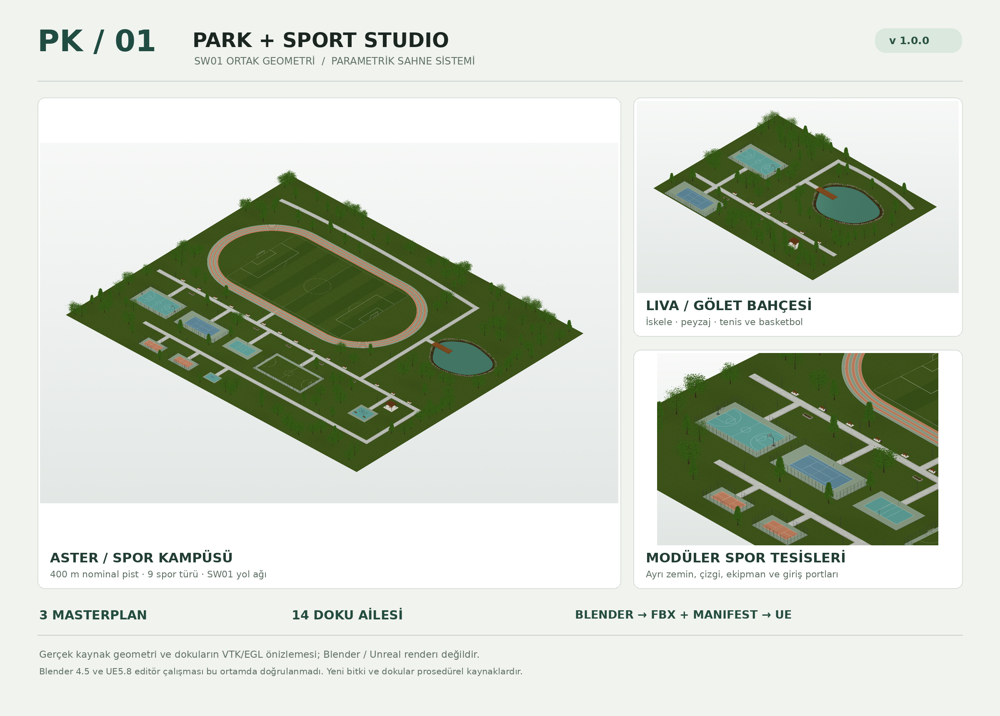
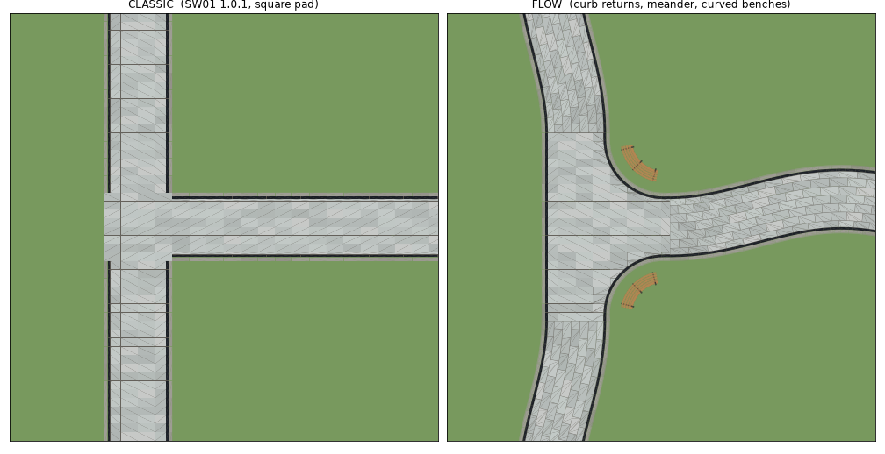

# Park • Sport • Sidewalk Studio

**PK01 1.1.0 · Blender scene authoring · FLOW curved sidewalks · SW01 1.0.1 integration · Unreal export bridge**

[**Türkçe rehber**](README_TR.md) · [Full add-on manual](pk01_park_studio/README_TR.md) · [Publication guide](docs/PUBLISH_TR.md)



> **Experimental source release.** Blender 4.5 is the authoring target and Unreal Engine 5.8 is the export target. Blender UI/API, FBX export and UE import have **not** been validated inside those applications. Repository smoke tests are not application compatibility tests. Try a blank scene first.

## The project

A procedural Blender add-on for sports parks, gardens, ponds, planting and coordinated sidewalk networks. It uses the original **SW01 geometry core**, rather than a look-alike sidewalk implementation.

| Module | Included source functionality |
|---|---|
| Masterplans | Aster sports campus, Mira neighborhood park, Liva lakeside garden |
| Sports | Basketball, tennis, football, futsal, volleyball, badminton, pickleball, table tennis and fitness |
| Landscape | Pond bowl and surface, rocks, reeds, planting exclusions and reproducible tree placement |
| Furniture | Soft-edged and curved benches, pergolas, picnic tables, planters, cycle racks, turned light poles and bollards |
| FLOW sidewalks | Path-following paving, profiled (bullnose/chamfer) jointed curbs, curb-return junctions, gentle meanders |
| Sidewalk bridge | Vendored SW01 core, shared material naming, port connections and style transfer |
| Export | Unique FBX mesh library, texture files and placement JSON; Unreal Editor importer source |

Generated trees and PBR surfaces are original procedural assets, **not photogrammetry or premium purchased libraries**. Sports markings and dimensions are scenery, not construction or competition certification.

## Install

This repository ZIP is **not** itself the Blender installation ZIP. Build the add-on archive from the repository root with Python 3.10+:

```bash
python tools/build_addon.py
```

The result is `dist/PK01_ParkSport_Studio_1_1_0.zip`. In Blender use **Preferences → Add-ons → Install from Disk**, choose that ZIP and enable PK01. Open the 3D Viewport sidebar with **N → PK01**. Do not run `__init__.py` as a standalone text script.

Start with **Liva / Draft / 40–60 trees**, Object Mode and Unit Scale 1.0. See the [original manual](pk01_park_studio/README_TR.md) for generation and export instructions. The build tool needs only the Python standard library, not Blender.

## FLOW curved sidewalks (1.1.0)



The default **FLOW** path style lays pavers in courses that follow the centre line, sweeps jointed curb stones from a bullnose, chamfer or square section, and replaces square junction pads with curb returns and rounded dead ends. Network links meander gently and still meet every junction mouth square and flush. Choose **CLASSIC** in the SW01 tab for the untouched SW01 1.0.1 output (byte-identical to 1.0.0). Details: [add-on manual](pk01_park_studio/README_TR.md) and [technical notes](pk01_park_studio/docs/TECHNICAL_TR.md). The preview is a plan-view geometry plot, not a Blender render.

## SW01 interoperability

`pk01_park_studio/vendor/sw01_core.py` and the shared texture files retain their supplied bytes and licensing. Both systems use `UV0_Tile`, `SW01_Tint`, and the `M_SW01_*` material names. Match sidewalk width and height before joining ports. PK01's vendored core works without opening the separate SW01 UI; copying settings from that UI requires the original SW01 script to be running.

The full standalone SW01 kit is **not** duplicated in this repository. Its shared geometry core and necessary textures are included within PK01.

## Validation

```bash
python -m unittest discover -s tests -v
```

These tests cover repository source syntax, the supplied file hashes, representative geometry/transform checks and package metadata. They also check that every FLOW solid is watertight, all junction arm combinations build, and CLASSIC sidewalks are unchanged. They do not run `bpy`, Unreal or the complete historical validation suite. The original [validation report](pk01_park_studio/docs/validation_report.json) is retained as a historical report, not a fresh CI result.

## Layout

```text
pk01_park_studio/     Blender add-on and vendored SW01 dependencies
  assets/textures/    Local PBR sources
  unreal/            Unreal import source, copied into each export by Blender
  vendor/            SW01 core and its original license
  docs/              Original technical notes and historical report
docs/                Publication instructions and scene previews
tests/               Runnable repository smoke tests
tools/               Add-on ZIP builder
Publish-GitHub.ps1    First-publication helper (Windows, Git + GitHub CLI)
YAYINLA.cmd          Windows launcher for the helper
```

## Scope and limits

No native `.uplugin`, live Unreal spline/PCG system, automatic terrain fitting, HISM/Foliage conversion, wind system, Nanite/LOD generation or native WaterBody is supplied. Blender performs geometry authoring; Unreal receives editor-imported assets and placements. Manually check scale, collisions, shading and regeneration behavior before production use.

## License

The original license notices are preserved without changes: source code is supplied under MIT; original generated assets have the supplied CC0 dedication. See [LICENSE.txt](LICENSE.txt) and [SW01 notice](pk01_park_studio/vendor/SW01_LICENSE.txt). External assets you add keep their own terms. This repository does not distribute Blender or Unreal Engine binaries and does not imply endorsement.
